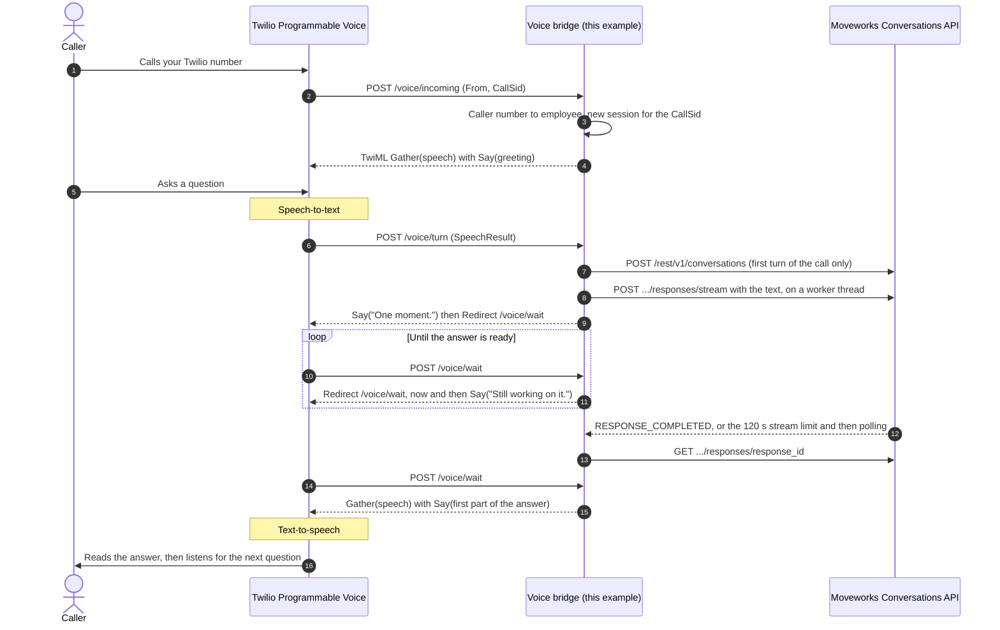

# Voice: a phone line for the Moveworks assistant

A runnable template for putting the Moveworks assistant behind a phone number. A caller asks a question out loud and hears the assistant's answer, in a conversation that keeps its context for the whole call.

The Conversations API is text in, text out. It has no audio endpoint, so this example is a bridge:

**phone call → speech-to-text → Conversations API turn (text) → text-to-speech → caller**

It uses [Twilio Programmable Voice](https://www.twilio.com/docs/voice). Twilio's `<Gather input="speech">` turns the caller's speech into text and `<Say>` reads the reply, so you need no separate speech vendor to try it. The parts that talk to the Conversations API (`bridge.py`, `speech.py`) don't depend on Twilio, so you can keep them when you move to another contact center platform (see [Use another platform](#use-another-platform)).

> [!IMPORTANT]
> **Expect tuning work.** It will take effort to tune your voice harness to work with the Moveworks orchestrator harness behind the Conversations API: prompts, turn-taking, how long answers run when spoken, and latency. This example gives you a working call loop to start that tuning from. It is not a finished voice agent.

---

## How a call works



Each Twilio webhook answers in a few seconds: Twilio stops waiting for a webhook after about 15 seconds, and an assistant turn that calls tools can take 10 to 30 seconds. So the turn runs on a worker thread while Twilio loops on `/voice/wait`, and the caller hears a short filler instead of silence.

## What the bridge handles

| Concern | What the code does | Where |
|---|---|---|
| **Text-only API** | Sends the transcript as an ordinary `chat` turn (capped at the API's 20,000 characters). Reads the reply's text and drops what a voice can't use: Markdown, URLs, emoji, tables, and the plain-text copy of offered forms. | `speech.py` |
| **Long answers** | Reads about 40 seconds at a time (`VOICE_MAX_SPEECH_CHARS`, split at sentence ends), then offers "Say more to keep going." The caller can say "more", "repeat that", or ask something new. | `speech.py`, `server.py` |
| **The 120-second stream limit** | Streams each turn, which costs one request where polling a 20-second answer costs about ten reads. A stream stops at 120 seconds even when the response is still running, so on that error, or a dropped stream, the bridge polls the response instead of failing the turn. | `bridge.py` |
| **Rate limits (429)** | A rate-limited stream open was never accepted, so the bridge submits the turn with `create_response`, which the shared client backs off and resends after a 429. Polling waits out a 429 too. When retries run out, the caller hears "The assistant is busy right now." A turn is never resent after a timeout or 5xx. | `bridge.py`, `moveworks_capi/client.py` |
| **One conversation per call** | Keeps a session per Twilio `CallSid` with its Conversations API `conversation_id`, so a follow-up such as "what about next year?" has context. A second utterance while a turn is running is not sent. | `bridge.py` |
| **Buttons** | Reads up to four button labels aloud ("You can say Submit, or Cancel") and presses the one the caller says, as a `callback_id` turn. | `server.py`, `speech.py` |
| **Links and forms** | Says that the answer has a link or form that can't be opened on a call. | `server.py` |
| **Hand-off to a person** | With `VOICE_TRANSFER_NUMBER` set, "agent" or "talk to a human" transfers the call with `<Dial>`. | `server.py` |
| **Request signatures** | Rejects any webhook without a valid `X-Twilio-Signature`. | `twiml.py` |

---

## Set up

You need a Moveworks instance set up for the Conversations API (see [Moveworks setup](../../README.md#moveworks-setup)), a Twilio account with a voice-capable phone number, and a way to give Twilio a public HTTPS URL for your machine, such as [ngrok](https://ngrok.com/) or `cloudflared`.

1. **Install** from the repo root, with the `app` extras for FastAPI and uvicorn.

   ```bash
   pip install -e ".[app]"
   ```

2. **Pick a Moveworks credential.**

   - **Self-signed JWT (S2S), recommended.** One key can act as any provisioned user, so each call runs as the employee who is calling: their tickets, their PTO, their permissions. Set the `MW_S2S_*` values from the [S2S setup](https://docs.moveworks.com/api-reference/conversations-api/set-up-service-to-service-authentication). `MW_S2S_USER_EMAIL` is not used; the user comes from the caller's number.
   - **HTTP Connector API Key.** Every call runs as the key's single service-account user. Fine for a demo line that answers general questions.

   Run `python examples/check_setup.py` first to confirm the credential works.

3. **Start a tunnel** to the bridge's port and note the public HTTPS URL.

   ```bash
   ngrok http 8095
   ```

4. **Fill in `.env`** (see [Environment variables](#environment-variables)). At minimum:

   ```bash
   MW_BOT_NAME=your-bot-name
   MW_AUTH=s2s
   # ...the MW_S2S_* values...
   TWILIO_AUTH_TOKEN=your-twilio-auth-token
   VOICE_PUBLIC_URL=https://abc123.ngrok-free.app
   VOICE_CALLERS=+15555550100=jane@example.com
   ```

5. **Run the bridge** from the repo root.

   ```bash
   python -m examples.voice
   ```

6. **Point your Twilio number at it.** In the Twilio Console, open **Phone Numbers > Manage > Active numbers**, choose the number, and under **Voice configuration**:

   - **A call comes in:** Webhook, `https://abc123.ngrok-free.app/voice/incoming`, HTTP POST.
   - **Call status changes:** `https://abc123.ngrok-free.app/voice/status`, HTTP POST. This lets the bridge drop a call's session when it ends.

7. **Call the number** from a phone listed in `VOICE_CALLERS` and ask something, such as "How much PTO do I have?"

**Common failures:**

- Every webhook returns `403` → `VOICE_PUBLIC_URL` doesn't match the URL Twilio calls (the signature covers the exact URL, including `https`), or `TWILIO_AUTH_TOKEN` is wrong. A new ngrok URL on each restart means updating both the Twilio number and `VOICE_PUBLIC_URL`.
- The call says "this line doesn't recognize the number" → the caller's number, in E.164 form such as `+15555550100`, is not in `VOICE_CALLERS`.
- The call says "I couldn't sign you in" → the employee in `VOICE_CALLERS` doesn't resolve against your Moveworks roster, or the credential is wrong. The bridge's log has the error.
- Every answer is "Sorry, I couldn't reach the assistant" → check the log, then run `python examples/check_setup.py`.

### Environment variables

| Variable | Purpose |
|---|---|
| `MW_BASE_URL`, `MW_BOT_NAME` | Your data center base URL and Bot Name, as for every example. |
| `MW_AUTH` | `s2s` (default) to act as each caller's employee, or `api-key` to act as one service-account user. |
| `MW_S2S_ISSUER`, `MW_S2S_AUDIENCE`, `MW_S2S_KEY_ID`, `MW_S2S_PRIVATE_KEY_PATH` | The S2S credential, for `MW_AUTH=s2s`. |
| `MW_API_KEY` | The API key, for `MW_AUTH=api-key`. |
| `TWILIO_AUTH_TOKEN` | Your Twilio account's auth token (Twilio Console, **Account info**). Used only to check request signatures. |
| `VOICE_PUBLIC_URL` | The public base URL Twilio calls, such as `https://abc123.ngrok-free.app`. |
| `VOICE_CALLERS` | Which numbers may call, and who each one acts as: `+15555550100=jane@example.com,+15555550101=raj@example.com`. Required for `s2s`. With `api-key`, an empty value lets any number call. |
| `VOICE_CALLERS_FILE` | The same map as a JSON file: `{"+15555550100": "jane@example.com"}`. |
| `VOICE_HOST`, `VOICE_PORT` | Bind address. Defaults to `127.0.0.1` and `8095`. |
| `VOICE_LANGUAGE` | Speech recognition and text-to-speech language. Defaults to `en-US`. |
| `VOICE_TTS_VOICE` | A [Twilio voice](https://www.twilio.com/docs/voice/twiml/say/text-speech), such as `Polly.Joanna`. Empty uses your account's default. |
| `VOICE_SPEECH_HINTS` | Comma-separated words that speech recognition should expect, such as your system and product names: `VPN, Okta, PTO, Workday`. |
| `VOICE_GREETING` | What callers hear first. |
| `VOICE_TRANSFER_NUMBER` | Where "agent" or "talk to a human" transfers the call, such as your service desk queue. Empty turns transfer off. |
| `VOICE_MAX_SPEECH_CHARS` | The longest stretch read before "Say more to keep going." Defaults to `600`, about 40 seconds. |
| `VOICE_TURN_TIMEOUT_SECONDS` | The longest a caller waits for one answer. Defaults to `150`. |
| `VOICE_STREAM` | `true` (default) streams each turn; `false` submits and polls. |
| `VOICE_CONTEXT_HINT` | Optional text sent ahead of the caller's first question in each call, such as `I'm on a phone call, so keep answers short and skip links.` Empty sends the caller's words as they are. |

---

## Caller identity

> [!WARNING]
> A phone number is not proof of identity. Caller ID can be spoofed, and with S2S the bridge acts as whichever employee the number maps to.

Before you put this in front of real employee data, verify the caller before the first turn runs as them: a one-time code sent to a device on file, an MFA push, or your contact center's own caller authentication. The place to add that check is `incoming()` in [`server.py`](server.py), between looking up the caller and starting the session. Until then, keep `VOICE_CALLERS` to test numbers you control, or use an API key bound to a service account that can only see general information.

## Tune it

These are the knobs most deployments turn first. Change one at a time and listen to real calls.

- **Recognition.** Set `VOICE_SPEECH_HINTS` to the names of your systems and apps. Speech recognition does poorly on internal names it has never heard.
- **Answer length.** Lower `VOICE_MAX_SPEECH_CHARS` for snappier calls. Try `VOICE_CONTEXT_HINT` to ask for shorter, link-free answers, and check that it doesn't change which tools the assistant picks.
- **Fillers and waits.** `FILLERS`, `STILL_WORKING`, and the other phrases are constants at the top of [`server.py`](server.py). A turn that calls several tools can take 20 seconds or more; tell callers what's happening rather than leaving silence.
- **Voice.** `VOICE_TTS_VOICE` picks a neural voice, which sounds much better than the basic ones.
- **Formatting.** [`speech.py`](speech.py) decides what is read aloud. Add rules there for patterns your assistant's answers use, such as ticket numbers you want read digit by digit.

## Use another platform

The bridge splits into a telephony layer and a Conversations API layer:

```
server.py, twiml.py     Twilio webhooks and TwiML       (replace for another platform)
bridge.py               callers, sessions, CAPI turns   (keep)
speech.py               reply text to speakable chunks  (keep)
```

Keep the same shape on any platform: start the turn, return to the caller with a filler, and fetch the answer in a later request. Contact center platforms give a webhook or function call only a few seconds.

- **Amazon Connect.** Use the contact flow's **Get customer input** block with Amazon Lex for speech-to-text, and **Play prompt** with Amazon Polly to read the answer. An **Invoke AWS Lambda function** block calls your code: one call starts the turn with `TurnRunner`, and the flow loops through a short prompt and a second Lambda call until the answer is ready. Keep the session in DynamoDB, keyed by the contact ID.
- **Genesys Cloud.** In an Architect inbound call flow, collect speech with the flow's speech recognition, call your bridge through a **Data Action**, and read the answer with text-to-speech. Loop on a second Data Action while the turn runs, keyed by the conversation ID.
- **Other speech-to-text and text-to-speech vendors**, or interruption while the answer is playing. Twilio [Media Streams](https://www.twilio.com/docs/voice/media-streams) and [ConversationRelay](https://www.twilio.com/docs/voice/twiml/connect/conversationrelay) let you bring your own speech vendors over a WebSocket. Send each final transcript to `TurnRunner.run` and pass `speech.chunk_for_speech` output to your text-to-speech.
- **A realtime voice model in front.** A speech-to-speech model can run the conversation itself, with small talk, interruptions, and fillers, and call the assistant as a tool whenever the caller needs something from your systems. That tool call is one Conversations API turn, with the same session, streaming, and rate-limit handling as here.

## Not included

- **Forms and modals by voice.** The bridge says a link or form exists but can't fill it. To finish on another device, text the link with Twilio Messaging.
- **The Get Help menu and live agent chat.** Live agent replies arrive as events, not on the call. Transfer the call to your contact center instead (`VOICE_TRANSFER_NUMBER`).
- **Proactive notifications on the call.** A follow-up that lands after the turn completes, such as a ticket confirmation, arrives through the events API, not on the call.
- **More than one process.** Sessions live in memory. To run more than one instance, keep them in a shared store such as Redis, keyed by `CallSid`.
- **Call recording and its notice.** If your contact center records calls, add the disclosure your policy requires to the greeting.

## Test

```bash
pip install -e ".[app,test]"
python -m pytest tests/test_voice.py
```

The tests run offline. They sign webhook requests the way Twilio does and mock the Conversations API, including the 120-second stream limit, a dropped stream, and a 429 on the stream open.
