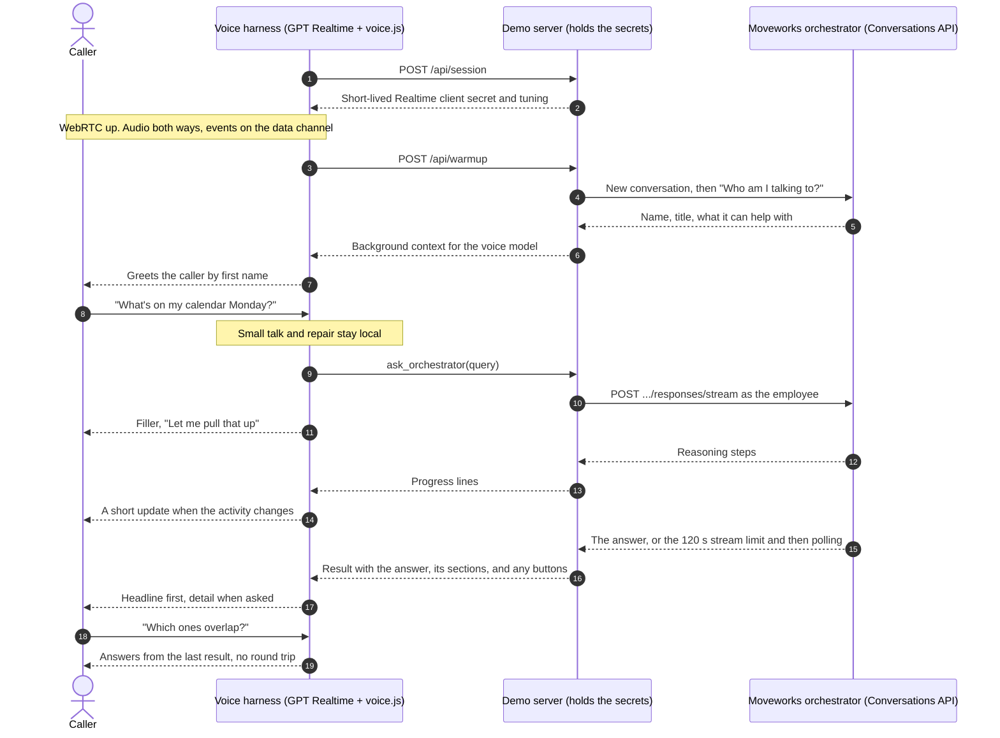

# Voice: two harnesses working together

A runnable template for talking to the Moveworks assistant by voice. You speak in the browser, and a realtime voice model answers, handing anything that needs your company's systems to the Moveworks orchestrator through the Conversations API.

> [!IMPORTANT]
> **It will take effort to tune your voice harness with our orchestrator harness.** Expect to tune both sides together against real calls: the voice prompts, turn-taking, filler timing, how answers are shaped and paced for the ear, and latency. This template gives you the working architecture to start from. It is not a finished voice agent.

The Conversations API is text in, text out. It has no audio endpoint. Voice comes from a second harness in front of it:

| | Voice harness | Orchestrator harness |
|---|---|---|
| **What runs it** | An OpenAI Realtime speech-to-speech model (`gpt-realtime-2.1` by default), driven by [`static/voice.js`](static/voice.js) | The Moveworks orchestrator behind the Conversations API, with the same assistant configuration as chat, running as the employee |
| **What it owns** | The conversation: listening, turn-taking, interruptions, small talk, covering the wait, pacing and delivery | The work: company knowledge, the employee's data, actions and their status, and the completeness and structure of answers |
| **How fast** | 1 to 3 seconds to first audio | 5 to 20 seconds a turn, sometimes longer |

The voice model hands work to the orchestrator by calling its `ask_orchestrator` tool. The model writes the query itself, as a self-contained request with names, dates, and pronouns resolved, so the orchestrator gets "Move my 1:1 with Priya on Monday, October 26 to 4:30 PM" rather than "move it".

---

## How a call works



A call, step by step:

1. **Session start.** The server mints a short-lived Realtime client secret with the voice harness's prompt, voice, turn detection, and the `ask_orchestrator` tool, and starts a voice session. The browser connects to the model directly over WebRTC. The OpenAI API key and the Conversations API credential never leave the server.
2. **Warm-up.** The voice model has no identity of its own. On connect, the browser asks the orchestrator who the caller is and what it can help with, and gives the answer to the voice model as background, so the greeting uses the caller's first name. This is the first turn of the call's conversation.
3. **A request.** The caller asks something that needs company data. The voice model calls `ask_orchestrator`, often with a short acknowledgement of its own. The server runs the turn as a Conversations API turn and streams progress lines back while it works.
4. **Covering the wait.** If the model didn't acknowledge, a neutral filler plays after about 2 seconds. After that, an update plays when the orchestrator reports new activity, but no closer than 5 seconds apart, and a brief reassurance plays if it has been quiet for 9 seconds. Fillers are spoken out of band, so they never become part of what the model remembers. Only one response plays at a time.
5. **The answer.** When the result arrives, any filler still playing is cut off, the result goes back to the model as the tool output, and the model delivers it: the headline first, every specific for a policy, one phase at a time for a how-to, a clarifying question as a question, a failure said plainly.
6. **Follow-ups.** "Which ones overlap?" or "next step" is answered from the result the model already has, with no new orchestrator turn. Anything new goes back to step 3 in the same conversation, so the orchestrator keeps context.
7. **Interruptions.** The caller can talk over the model at any time; the Realtime model stops speaking and listens. If the caller talks over a pending orchestrator turn, the lookup is cancelled (`VOICE_CANCEL_ON_BARGE_IN`). The turn may still finish on the server, and its answer stays in the conversation's history.

### What the template handles on the Conversations API side

| Concern | What the code does | Where |
|---|---|---|
| **Text only** | Sends the voice model's query as an ordinary `chat` turn (capped at 20,000 characters). Strips what no voice should read from the answer (Markdown, URLs, emoji, tables, the plain-text copy of offered forms) and keeps every fact. | `speech.py` |
| **Long and structured answers** | Splits an answer at its labelled phases, steps, or headings, and otherwise into pieces of about 40 seconds, so the model can deliver one at a time. | `speech.py` |
| **The 120-second stream limit** | Streams each turn, which costs one request where polling a 20-second answer costs about ten reads, and takes the answer from the stream itself. A stream stops at 120 seconds even when the response is still running, so on that error, or a dropped stream, the turn switches to polling instead of failing. | `orchestrator.py` |
| **Rate limits (429)** | A rate-limited stream open was never accepted, so the turn is submitted with `create_response`, which the shared client backs off and resends after a 429. When retries run out, the voice model hears that the orchestrator is busy. A turn is never resent after a timeout or 5xx, and one voice session runs one turn at a time. | `orchestrator.py`, `moveworks_capi/client.py` |
| **One conversation per call** | Each voice session is one Conversations API conversation, starting with the warm-up. | `orchestrator.py` |
| **Buttons, links, and forms** | Lists button labels in the result; when the caller picks one, the model calls `ask_orchestrator` with `choice` and the server sends that button's `callback_id`. A link or form is flagged so the model can say there's one to open on a screen. | `orchestrator.py` |
| **Every failure is speakable** | Busy, still running after `VOICE_TURN_TIMEOUT_SECONDS`, not signed in, or unreachable: each comes back as a result with a status and a note the model can say. | `orchestrator.py` |

---

## Set up

You need a Moveworks instance set up for the Conversations API (see [Moveworks setup](../../README.md#moveworks-setup)) and an OpenAI API key with access to the Realtime API.

1. **Install** from the repo root, with the `app` extras for FastAPI and uvicorn.

   ```bash
   pip install -e ".[app]"
   ```

2. **Pick a Moveworks credential.** The demo acts as one employee.

   - **Self-signed JWT (S2S).** Set the `MW_S2S_*` values from the [S2S setup](https://docs.moveworks.com/api-reference/conversations-api/set-up-service-to-service-authentication), with `MW_S2S_USER_EMAIL` as the employee the demo acts as.
   - **HTTP Connector API Key.** Set `MW_API_KEY`; the demo acts as the key's user.

   Run `python examples/check_setup.py` first to confirm the credential works.

3. **Add the OpenAI key** to `.env`:

   ```bash
   OPENAI_API_KEY=sk-...
   ```

4. **Run the demo** from the repo root, then open http://127.0.0.1:8095 in Chrome, Edge, or Safari, choose **Connect**, and allow the microphone.

   ```bash
   python -m examples.voice
   ```

   Ask "What can you help me with?", then something that needs your data, such as "What's on my calendar tomorrow?" The page shows the call in three lanes: the caller, the voice harness (what the model says and when it hands off), and the orchestrator harness (its progress and results).

The server binds to 127.0.0.1 and accepts only same-origin requests from the page, because anything that can reach it acts as your credentials. Don't expose it on a network.

**Common failures:**

- **"Could not start the voice model"** → `OPENAI_API_KEY` is missing or wrong, or the key's project has no Realtime access. The server log has OpenAI's error.
- **"The voice model refused the connection"** → the client secret expired before the browser connected (it lasts 10 minutes), or the model name in `OPENAI_REALTIME_MODEL` isn't available to your key.
- **Every answer is "the orchestrator couldn't be reached"** → check the server log, then run `python examples/check_setup.py`.
- **No microphone prompt** → the page must be opened as `http://127.0.0.1` or `http://localhost`; browsers allow the microphone only on secure origins.

### Environment variables

| Variable | Purpose |
|---|---|
| `OPENAI_API_KEY` | Your OpenAI API key. Used only by the server, to mint each session's client secret. |
| `MW_BASE_URL`, `MW_BOT_NAME` | Your data center base URL and Bot Name, as for every example. |
| `MW_AUTH` | `s2s` (default) or `api-key`. |
| `MW_S2S_ISSUER`, `MW_S2S_AUDIENCE`, `MW_S2S_KEY_ID`, `MW_S2S_PRIVATE_KEY_PATH`, `MW_S2S_USER_EMAIL` | The S2S credential and the employee the demo acts as, for `MW_AUTH=s2s`. |
| `MW_API_KEY` | The API key, for `MW_AUTH=api-key`. |
| `VOICE_PORT` | Port to serve on. Defaults to `8095`. `--port` overrides it. |
| `OPENAI_REALTIME_MODEL` | The voice model. Defaults to `gpt-realtime-2.1`. |
| `VOICE_REALTIME_VOICE` | The model's voice, such as `marin` (default) or `cedar`. |
| `VOICE_SPEED` | Speaking speed. Defaults to `1.0`. |
| `VOICE_VAD_EAGERNESS` | How quickly the model decides the caller has finished: `low`, `medium` (default), `high`, or `auto`. |
| `VOICE_GLOSSARY` | Comma-separated company terms, names, and acronyms. Biases the caller transcript and tells the model how to say them. |
| `VOICE_PROMPTS_DIR` | A folder with your own copies of the files in [`prompts/`](prompts/). |
| `VOICE_WARMUP` | `off` skips the warm-up turn. |
| `VOICE_PROGRESS_MIN_MS`, `VOICE_PROGRESS_MAX_MS` | The closest two updates can be while the orchestrator works (default `5000`), and the longest silence before a reassurance (default `9000`). |
| `VOICE_CANCEL_ON_BARGE_IN` | `false` keeps a pending orchestrator turn when the caller talks over it. |
| `VOICE_STREAM` | `false` submits and polls instead of streaming. |
| `VOICE_TURN_TIMEOUT_SECONDS` | The longest one orchestrator turn may take before the model hears it's still running. Defaults to `150`. |

---

## Tune it

Most problems cross the boundary between the two harnesses, so fix them on both sides and replay the same calls:

| What goes wrong | Voice harness change | Orchestrator change |
|---|---|---|
| Policy or benefits details get lost in a summary | Keep every material specific; don't summarize | Return complete eligibility, conditions, and exceptions |
| Step-by-step instructions are hard to follow in one pass | Deliver one phase, then pause for "next" or "repeat" | Return complete instructions organized in labelled phases |
| A filler implies an action is happening ("submitting that now") | Neutral, truthful progress wording | Keep action status and completion explicit |

The voice side's controls:

- **Prompts**, in [`prompts/`](prompts/): `voice_instructions.md` (persona, what stays local and what goes to the orchestrator, how to deliver results), `delegation.md` (the tool description the model reads before handing off), `welcome.md`, `warmup.md`, `filler.md`, and `progress.md`. Copy the folder and point `VOICE_PROMPTS_DIR` at it to keep your own.
- **Turn-taking:** `VOICE_VAD_EAGERNESS`, and the rest of the turn detection in [`realtime.py`](realtime.py).
- **Filler timing:** `upfront_filler_ms` (by `quick` or `long` lookups, which the model sets on each call), `VOICE_PROGRESS_MIN_MS`, and `VOICE_PROGRESS_MAX_MS`, in [`tuning.py`](tuning.py).
- **Recognition and pronunciation:** `VOICE_GLOSSARY`. The Realtime model has no custom vocabulary list, so this works through prompts.
- **Voice:** `VOICE_REALTIME_VOICE` and `VOICE_SPEED`. Voice choice drives a lot of how natural a call feels.

The orchestrator side's controls (answer shape, instructions for voice traffic, which tools a voice assistant can use) are in your Moveworks assistant's configuration; work through them with your Moveworks account team. Every orchestrator turn the demo sends lands in a normal Conversations API conversation you can review.

Review real calls end to end before you change anything: what the caller said, what the voice model said and when, and what the orchestrator returned. The three lanes on the page show that for each call.

---

## Put it on a phone line

This template runs in the browser. For a phone line, keep the same two harnesses and change how audio reaches the voice model:

- **Bring the call's audio to a Realtime session**, either over SIP into the Realtime API or through a media stream such as Twilio Media Streams. Phone audio is G.711 μ-law at 8 kHz, which the Realtime API accepts directly (`audio/pcmu`), with no transcoding.
- **Run the voice harness loop on your server.** The hand-off in [`static/voice.js`](static/voice.js) (tool call, fillers, progress, delivery, barge-in) moves server-side, and calls the same `Orchestrator` in [`orchestrator.py`](orchestrator.py).
- **Verify the caller before the first orchestrator turn runs as them.** A phone number is not proof of identity. Use your contact center's caller authentication, a one-time code, or an MFA push, then sign the S2S token for that employee.
- **Keep the warm transfer to a person** in your contact center, and hand over the transcript.

## Not included

- **A phone line.** See [Put it on a phone line](#put-it-on-a-phone-line).
- **Employee sign-in.** The demo acts as one employee from `.env`. A real deployment signs the employee in, then signs each S2S token for that employee.
- **Call recording and history.** Add your own, with the notice your policy requires.
- **More than one process.** Voice sessions live in memory.
- **Cost and data controls.** Speech-to-speech audio is billed by OpenAI per use, and the caller's audio goes to OpenAI. Check both against your policies before a pilot.

## Test

```bash
pip install -e ".[app,test]"
python -m pytest tests/test_voice.py
```

The tests run offline with OpenAI and the Conversations API mocked, including the 120-second stream limit, a dropped stream, a 429 on the stream open, a cancelled lookup, and one turn through the real client over a mock HTTP session.
